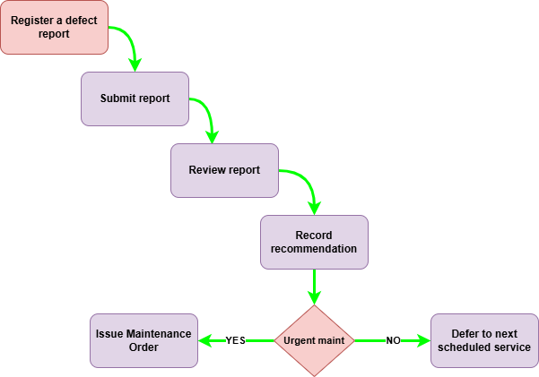
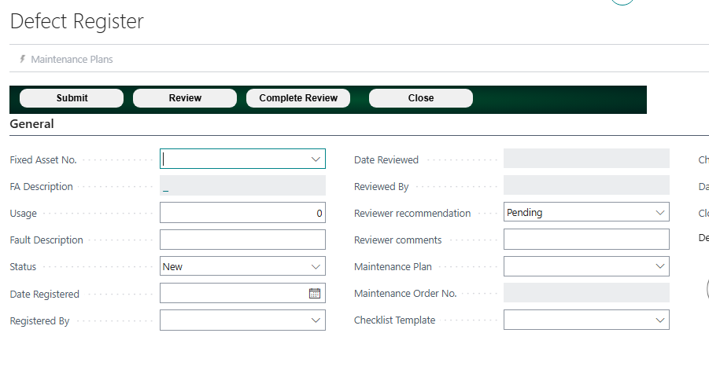

# Defect Register
The defect register provides a quick, simple way to report faults or issues on an asset, which the operator may notice in the course of normal operation.

## The Process
- The asset operator registers a defect report. This may be a minor issue which does not affect the operation of the asset, or it may be a more serious issue which requires immediate attention.
- The report is submitted. 
- A person designated as a 'Reviewer' (a supervisor, manager or technical specialist) 

**Open the Defect Register list**
From the Asset Maintenance role centre, click on one of the defect cue:

Alternatively, search for Defect Register.

The list of defects will be displayed.

You can use the prebuilt views to select defects by status:

**Create a new defect report**
From the role centre, click on '+ Defect Register', or from the Defect Register list, click on 'New'. The Defect report card will open.

Capture the report as follows:

|Field|Value|
|---|---|
|Fixed Asset No.|Select an asset from the drop down|
|Usage Reading |Enter the running usage value eg odometer reading|
|Fault Description|Enter a short description of the fault being reported|
|Registered By|Defaults to current user; amend as required|
