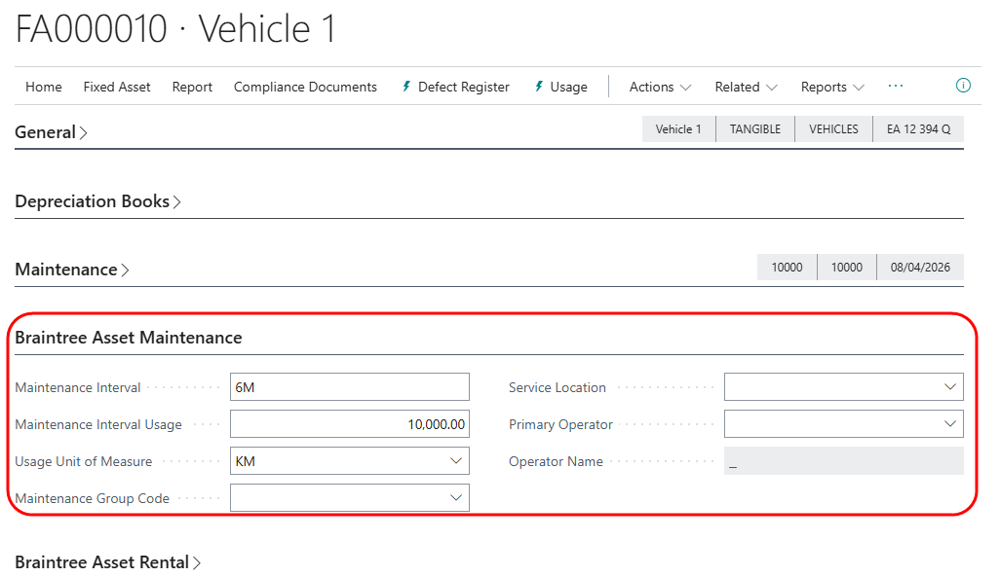

# Fixed Asset Master
To facilitate maintenance, some new fields are added to the fixed asset card, on the Tab 'Braintree Asset Maintenance':

| **Field** | **Definition** |
|---|---|
|Maintenance Interval       |Defines the time interval between planned maintenance, entered as a DateFormula. For example, '3M' means 3 months  |
|Maintenance Interval Usage |Defines the interval between planned maintenance, based on asset utilisation. Typically measured in KM's or running hours|
|Usage Unit of Measure      |Defines the unit of measure for utilisation.|
|Maintenance Group Code     |Associates the asset with a maintenance group. This can be assigned automatically by associating the asset subclass with a maintenance group. Select from the dropdown.|
|Service location           |Defines the default stock location from which spares will be issued to maintenance orders|
|Primary Operator           |Defines the user who is the primary operator of the asset|