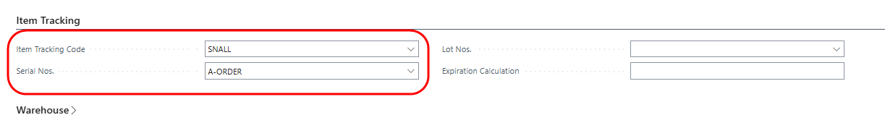
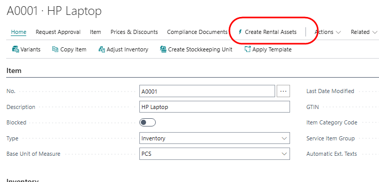
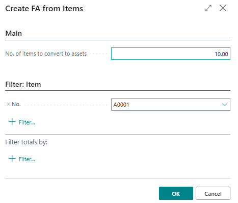

# Managing Inventory Items for Rental
Inventory items can be easily converted into fixed assets, which can be rented out to 3rd parties.

To prepare an inventory item for use as a rental asset:
- Create the item as normal.
- On the 'Item Tracking' tab, assign a tracking code that has been configured for Serial Number tracking.
- If you plan to use your own serial numbers, assign a number series into the 'Serial Nos.' field

# Purchase inventory
- Using normal Business Central procurement processes, purchase inventory for the item. 
- Assign serial numbers to the items being purchased.
- Receive the items into inventory.

# Create Fixed Assets from inventory
Before issuing the items for rental, they must be converted from inventory to fixed assets.
From the Item card, click on 'Create Rental Assets'.

A dialogue box will be displayed:

Enter the quantity of items that you want to assign to fixed assets, and click OK.
