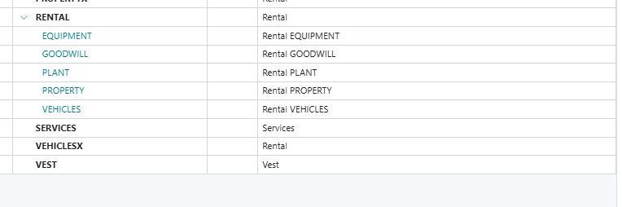

# Rentals
Fixed Asset Rentals provides a simple process to move an asset from one physical location to another. It works similarly to inventory transfers.

## Configuration
Before you can use asset rentals, there are a few basic setups required:

### No. Series
On installation, new number series will be automatically be created for 
- Rental Contracts
- Rental Assets

Under 'FA Maintenance Setup', the default number series will be set up.

### Item Categories
If you are going to convert inventory items to Fixed Assets, it will be useful to link item categories to fixed asset subclasses. 
On installation, the system creates an item category parent called 'Rental'. For each asset subclass defined, an item category will be created under Rental.

Example:

## Create a rental contract